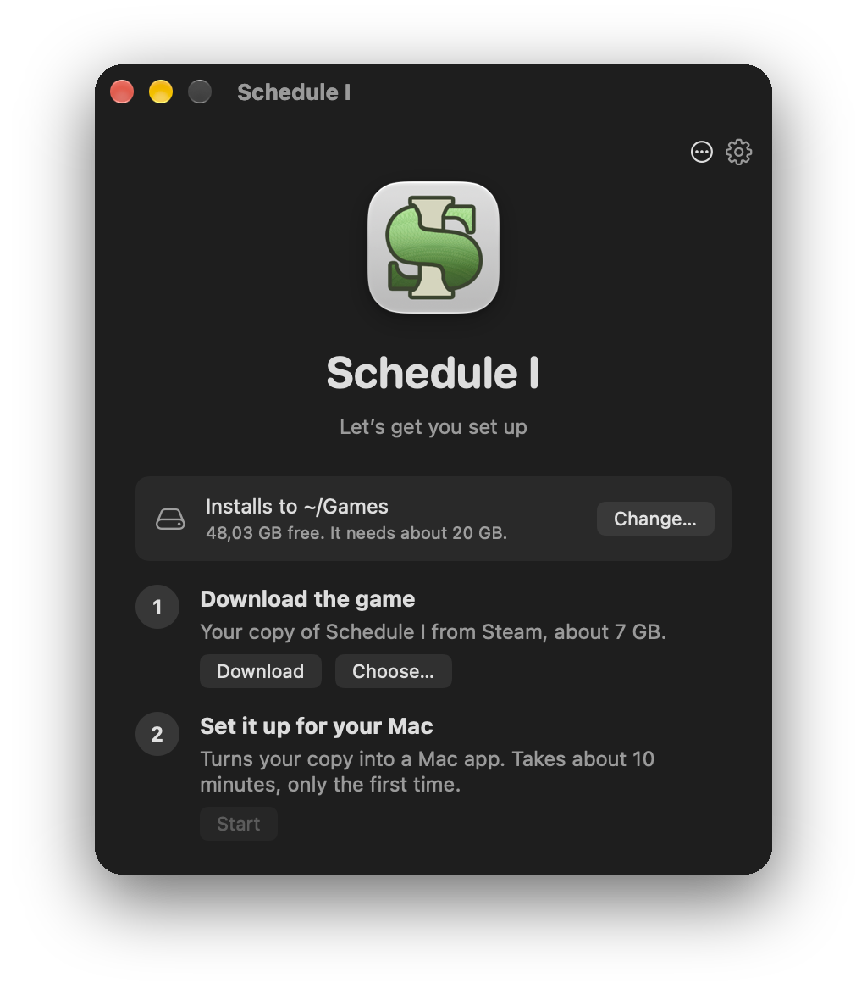
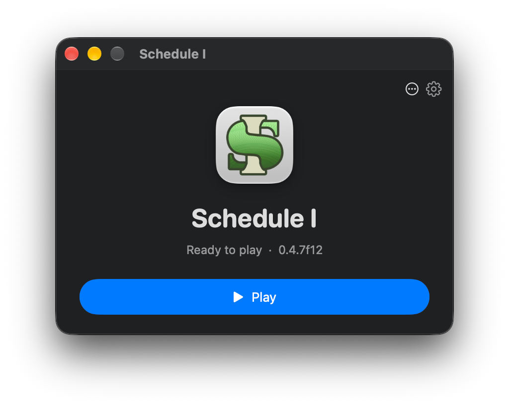
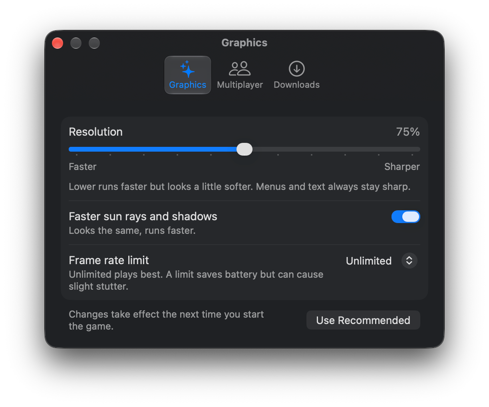
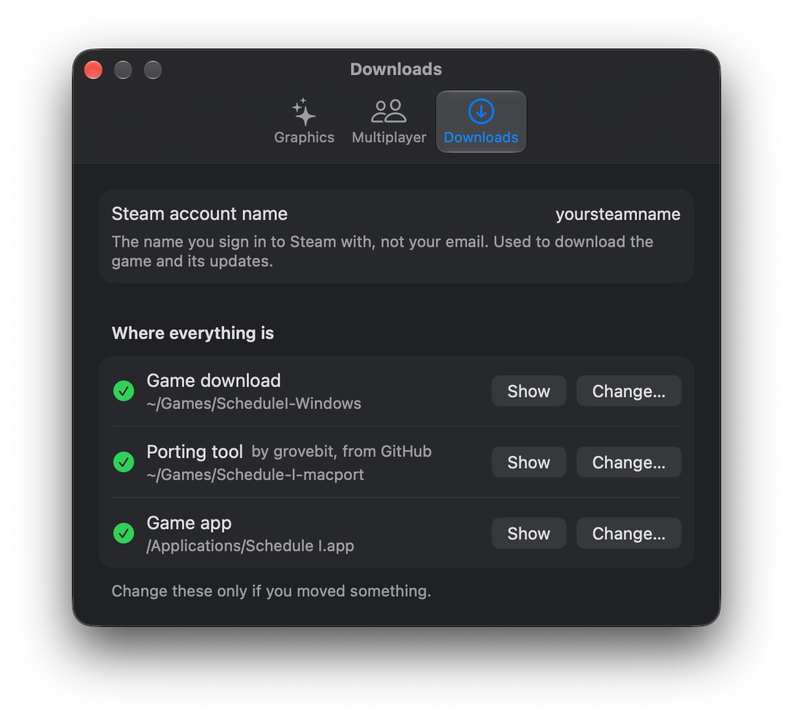

# Schedule I Launcher

A small Mac app that sets up, updates and starts Schedule I with this port, without Terminal.

<p>
  
  
</p>

## What it does

- **Setup in two steps:** downloads your Windows copy of the game from Steam (the `alternate` branch, with
  Valve's SteamCMD) and builds the Mac app with this repository's `build.sh`, with progress bars. It shows where it
  installs, checks free space, and offers Apple's developer tools if they're missing.
- **Game updates:** checks Steam for a new `alternate` build at startup (anonymously, no sign-in) and installs it
  with one click. Steam on a Mac can't do this, as it doesn't offer Windows-only games.
- **Settings in plain language:** render scale, faster sun rays and shadows, frame rate limit, and playing with
  friends on Steam's regular branch.
- **Play** starts Steam first if it isn't running.

Steam asks for the password and Steam Guard code in small sign-in windows. They go straight to SteamCMD and are never
saved. SteamCMD is downloaded from Valve into `~/Library/Application Support/Schedule I Launcher`.

<p>
  
  
</p>

## Build

```sh
launcher-app/build.sh
```

This puts `Schedule I Launcher.app` in Applications. It uses this repository as its porting tool, so keep the folder.
If the game app was built before, the launcher gets its icon.

## Notes

- "Faster sun rays and shadows" needs `MacPortFeatures` (#2), and "Play with friends on Steam's regular branch" needs
  `--main-branch-version` (#1). Without them, the launcher greys these settings out.
- Settings are written to the game's preferences (`com.TVGS.ScheduleI`) only while the game is closed, since the game
  saves its own preferences when it quits.
- Tested on a 14" MacBook Pro (M2 Pro): the setup screen, update checks and settings. Downloading the game and
  building it from the launcher aren't tested from start to finish yet.
